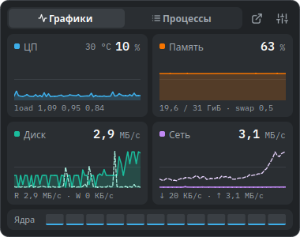
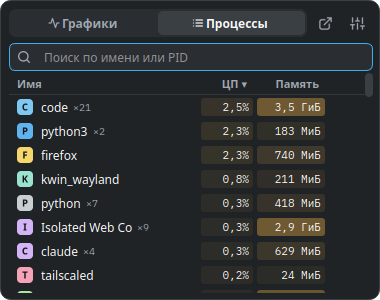
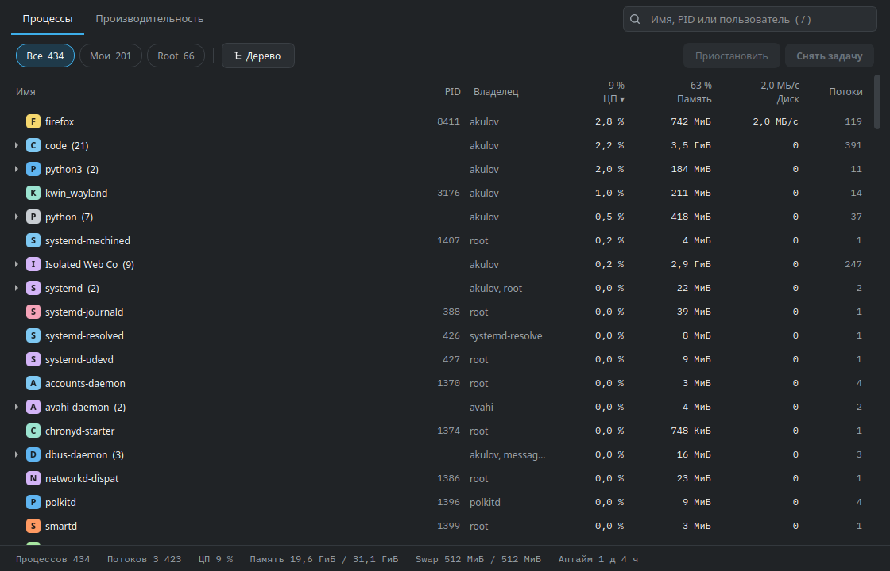
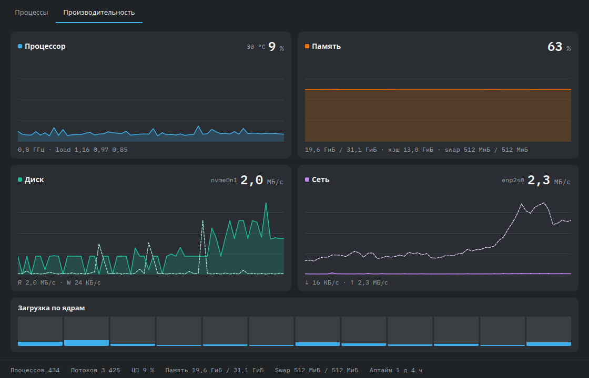

# Trayscope

Нагрузка системы и мини-диспетчер задач в системном трее Linux и Windows. Изначально сделан под KDE Plasma.

<p>
  
  
</p>





- **Значок в трее**: столбики ЦП/ОЗУ, мини-график ЦП или число процентов (на выбор).
- **Всплывающая панель** у значка: графики ЦП, памяти, диска и сети, загрузка по ядрам, температура и список самых «тяжёлых» процессов.
- **Диспетчер задач**: дерево процессов с поиском, завершением, приостановкой, сменой приоритета (nice / класс приоритета Windows) и подробностями по процессу, плюс вкладка производительности.

## Установка

```bash
git clone https://github.com/AkulovAlex96/trayscope.git
cd trayscope
pip install -r requirements.txt   # или из пакетов дистрибутива: python3-pyqt6 python3-psutil
./tray_monitor.py
```

Нужны Python 3.10+, PyQt6 (в Linux — с модулем QtDBus) и psutil.

### Windows

```powershell
git clone https://github.com/AkulovAlex96/trayscope.git
cd trayscope
python -m venv .venv
.venv\Scripts\pip install -r requirements.txt
.venv\Scripts\pythonw tray_monitor.pyw    # без окна консоли
```

`tray_monitor.pyw` можно запускать двойным щелчком. Новые значки Windows 11 прячет
в скрытую область трея (стрелка `^`); чтобы значок был виден всегда, перетащите его на панель задач.

## Запуск

| Команда | Действие |
|---|---|
| `tray_monitor.py` | запустить (если уже запущен — показать панель) |
| `tray_monitor.py --popup` | показать панель |
| `tray_monitor.py --manager` | открыть диспетчер задач (удобно повесить на Ctrl+Shift+Esc) |

Запускается один экземпляр: повторный вызов передаёт команду уже работающему.
Автозапуск при входе включается в меню значка.

**Мышь:** левый клик по значку открывает панель, средний — диспетчер задач, правый — меню.

**Клавиши в диспетчере:** `/` или `Ctrl+F` — поиск, `Delete` — завершить процесс, `Shift+Delete` — убить.
В панели: `Esc` — закрыть, `Ctrl+Tab` — переключить вкладку.

## Совместимость

| Система | Статус |
|---|---|
| KDE Plasma 5/6, X11 и Wayland | полностью; панель встаёт точно у трея (позиция панели берётся у plasmashell по D-Bus) |
| XFCE, Cinnamon, MATE, LXQt, Budgie | работает; положение панели определяется приблизительно |
| GNOME | нужно расширение AppIndicator / KStatusNotifierItem |
| Sway, Hyprland и др. | нужна панель с треем (например, waybar); положение панели может быть неточным |
| Windows 10/11 | работает; панель встаёт над значком в трее, автозапуск через реестр (HKCU\…\Run) |
| macOS | не поддерживается |

Особенности Windows: температура ЦП недоступна (psutil её не отдаёт), вместо load average
показывается число процессов, владелец служб без прав администратора не виден — такие
процессы попадают в фильтр «Система». Приоритет меняется классами Windows («Высокий»,
«Ниже среднего» и т. д.); для повышения приоритета чужих процессов нужен запуск от администратора.

Под Wayland приложение по умолчанию работает через XWayland, потому что иначе
окно нельзя поставить рядом с треем. Отключить: `TRAYMON_WAYLAND=1`.
